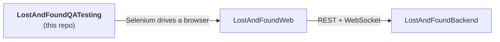

# 🧭 Lost & Found Nepal: QA Testing

Automated end-to-end UI tests for **Lost & Found Nepal**, written with **Selenium WebDriver** and **TestNG**. The suite opens the web app in a real browser and checks that it works the way a user would expect.

🌐 **App under test:** [lostandfoundnepal.com](https://lostandfoundnepal.com)

> **A personal project.** I built this on my own to practise test automation alongside the app itself. It isn't affiliated with any organisation.


---

## 🔗 Part of a 3-repo project

| Repo | Role | |
|---|---|---|
| [LostAndFoundWeb](https://github.com/maheshzrawal333/LostAndFoundWeb) | React frontend | The UI these tests drive |
| [LostAndFoundBackend](https://github.com/maheshzrawal333/LostAndFoundBackend) | Spring Boot API, auth, database, images, email | Exercised indirectly here; has its own Postman API tests |
| **LostAndFoundQATesting** | Selenium + TestNG end-to-end tests | 👈 *you are here* |



These are **end-to-end tests**. A passing run means the [frontend](https://github.com/maheshzrawal333/LostAndFoundWeb) and the [backend](https://github.com/maheshzrawal333/LostAndFoundBackend) are working together. A failure could come from either side, so check both when something breaks.

The backend repo also has **Postman API automation tests** that call the API directly, with no browser involved. If a UI test fails, run those first. They help you tell whether the problem is in the API or in the UI.

## 🎯 What's tested

Browser-level checks of the app's main user flows, such as loading the site, signing in, and reporting or claiming an item. The tests live under `src/test`.

## 🧰 Tech stack

| Area | Tools |
|---|---|
| Language | Java 23 |
| Browser automation | Selenium WebDriver 4.49 (`selenium-java`, `selenium-support`) |
| Test framework | TestNG 7.12 |
| Build | Maven |

## 🚀 Getting started

**Requirements**

- JDK 23 (as configured in `pom.xml`)
- Maven
- A browser such as Chrome. Selenium Manager downloads the matching driver automatically.
- A running target: either the [live site](https://lostandfoundnepal.com) or a local frontend and backend

```bash
git clone https://github.com/maheshzrawal333/LostAndFoundQATesting.git
cd LostAndFoundQATesting
mvn test
```

### Choosing what to test against

| Target | How |
|---|---|
| **Live site** | Use `https://lostandfoundnepal.com` as the base URL |
| **Local** | Start the [backend](https://github.com/maheshzrawal333/LostAndFoundBackend), then the [frontend](https://github.com/maheshzrawal333/LostAndFoundWeb), and use the local frontend URL (for example `http://localhost:5173`) |

Set the base URL wherever your tests define it.

### Useful commands

```bash
mvn test                        # run the whole suite
mvn -Dtest=YourTestClass test   # run one test class
mvn clean test                  # clean build, then run everything
```

## ⚠️ Good practice

- Tests that create data (accounts, reports) add it to whichever environment they target. Prefer a local setup or disposable test accounts over real user data.
- Test credentials should stay out of the repo. Keep them in environment variables or a local, git-ignored file.
- When the [frontend](https://github.com/maheshzrawal333/LostAndFoundWeb) changes button text, labels or layout, update the affected locators here.
- The live backend may be slow to respond after being idle, so use explicit waits and not fixed sleeps.

## 📁 Repository layout

```
LostAndFoundQATesting/
├── src/test/        # Selenium + TestNG tests
└── pom.xml          # Dependencies and Java version
```

## 📄 License & usage

Personal project with no open-source license applied yet. You're welcome to read the code and learn from it. If you'd like to reuse any of it, please get in touch first.

## 👤 Author

Built by **[@maheshzrawal333](https://github.com/maheshzrawal333)**. Issues and ideas are welcome.
